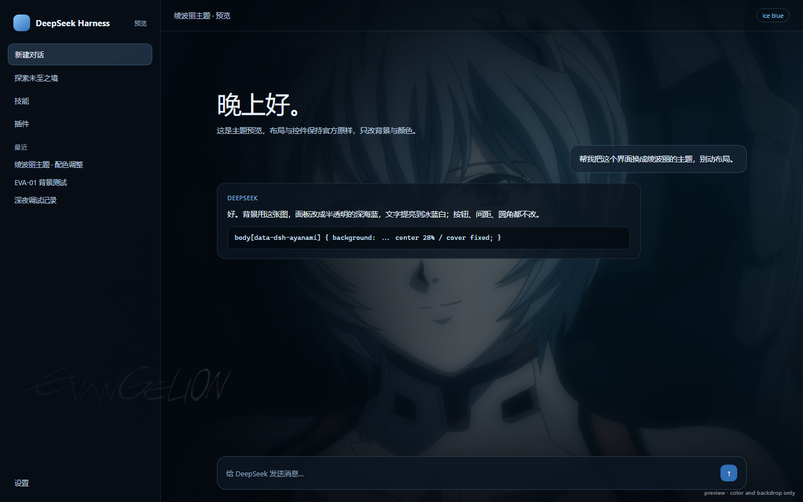

# dsh-ayanami-theme

绫波丽（EVA）主题插件，用于 DeepSeek Harness 桌面端。
整窗固定壁纸 + 半透明冰蓝界面；只改配色与背景，布局、间距、控件尺寸全部沿用官方默认。



## 特性

- **固定整窗壁纸**：静态背景图打底，叠加「女神的微笑」循环视频（9 秒动画 + 固定 500ms 停顿）。
- **半透明冰蓝配色**：覆盖 `--dsw-*` 表面、文字、边框与强调色令牌，亮色 / 暗色外观都适配。
- **保证可读性**：菜单、弹窗与输入框保持足够不透明度。
- **零侵入**：不加侧栏项、不加设置页、不改布局几何。

## 安装

前置条件：已安装 DeepSeek Harness 桌面端，且能正常打开 GUI。

1. 克隆到你喜欢的目录（下面以 `~/.dsh/plugin-src/dsh-ayanami-theme` 为例）：

   ```powershell
   git clone https://github.com/ayanamirei0/dsh-ayanami-theme.git "$env:USERPROFILE\.dsh\plugin-src\dsh-ayanami-theme"
   ```

2. 把插件链接到 `desktop` profile（把 `<DSH 安装目录>` 换成你自己的，例如 `D:\software\dsh`）：

   ```powershell
   $env:ELECTRON_RUN_AS_NODE = '1'
   & "<DSH 安装目录>\DeepSeek Harness.exe" --expose-internals `
     "<DSH 安装目录>\resources\app.asar\dsh\node_modules\@deepseek-ai\dsh-desktop-host\lib\cli.js" `
     plugin --profile desktop add "link:$env:USERPROFILE/.dsh/plugin-src/dsh-ayanami-theme"
   ```

3. 重启 DSH；进入界面后按 **Ctrl+Shift+R** 硬刷新一次（客户端 bundle 带不可变缓存头）。

**手工安装（与上面的命令等价）**：编辑 `~/.dsh/profiles/desktop/package.json`，在 `dependencies` 中加入

```json
"dsh-ayanami-theme": "link:<插件目录的绝对路径>"
```

再把它加进同一个文件的 `dsh.profile.bundles` 数组：

```json
"dsh.profile.bundles": ["@deepseek-ai/dsh-base", "@deepseek-ai/dsh-web-app", "dsh-ayanami-theme"]
```

然后让 profile 重新装依赖并重启 DSH。

### 卸载

```powershell
$env:ELECTRON_RUN_AS_NODE = '1'
& "<DSH 安装目录>\DeepSeek Harness.exe" --expose-internals `
  "<DSH 安装目录>\resources\app.asar\dsh\node_modules\@deepseek-ai\dsh-desktop-host\lib\cli.js" `
  plugin --profile desktop remove dsh-ayanami-theme
```

再删掉插件目录并重启 DSH。

## 自定义

- **壁纸位置 / 暗度**：改 `lib/client.js` 里两处 `background-image`（`linear-gradient(...)` 图层与 `center 28%`）。
- **表面透明度**：改 `TOKENS` 表里 `--dsw-alias-bg-base`、`--dsw-alias-bg-layer-1/2/3`、`--dsw-specific-sidebar-fill` 的 alpha 值。调低能看到更多画面，但文字对比度会下降。
- **强调色**：`--dsw-alias-brand-primary` 与 `--dsw-alias-link`。
- **循环节奏**：`lib/client.js` 中 `scheduleReplay` 的 `delay`（当前固定 500ms）。
- **换图**：替换 `assets/background.jpg`（或 `assets/smile.mp4`），无需改代码 —— host 端按请求实时读取文件，硬刷新即可生效。

## 目录结构

```
assets/           背景图、循环视频、EVA 标识
lib/index.js      host 端：注册 /dsh-ayanami-theme/* 媒体路由
lib/client.js     浏览器端：注入壁纸与设计令牌
cordis.patch.yml  bundle 补丁，挂载本插件
preview.html      单页预览，preview.png 由它渲染
```

## 兼容性

- 面向 DeepSeek Harness 桌面端（Electron + `dsh-app://app` 源），纯客户端注入，不依赖具体版本 API。
- 在 Windows + DSH 桌面端（Electron）实测通过，其他平台未验证。若遇样式错位，多半是 `--dsw-*` 令牌已改名，按 `TOKENS` 表对照修正。

## 版权与免责

- **代码**：MIT，见 [LICENSE](LICENSE)。
- **素材**：`assets/` 下的背景图、`smile.mp4`、`mark.png` 以及 `preview.png` 属《新世纪福音战士》同人素材，版权归 khara 及各权利人所有。**仅供个人非商业使用，请勿商用或二次分发。**
- 循环视频片段取自公开视频平台，仅作本地个人使用。

如果权利人认为本仓库不当，请提 issue，我会立即移除相关素材。